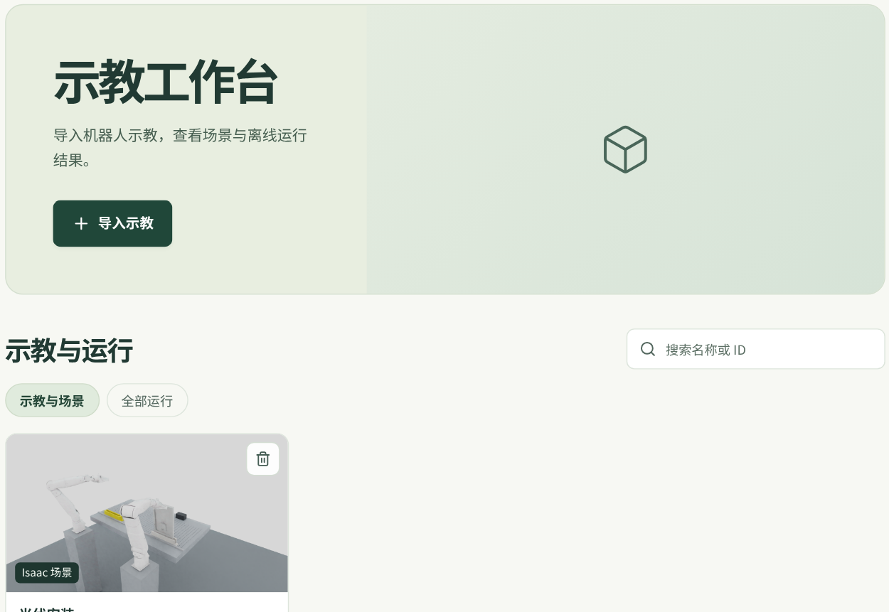
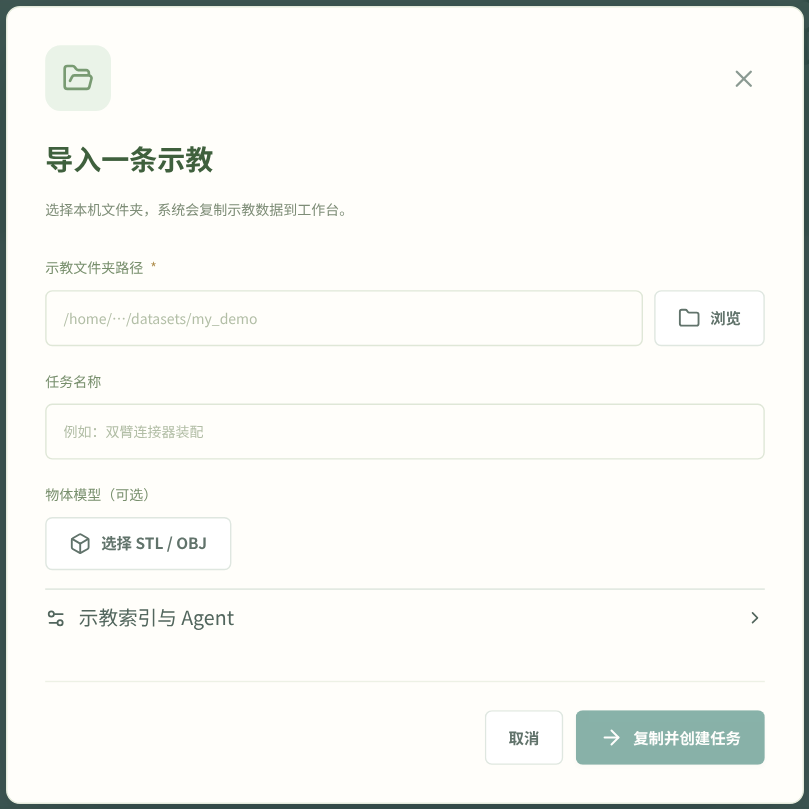
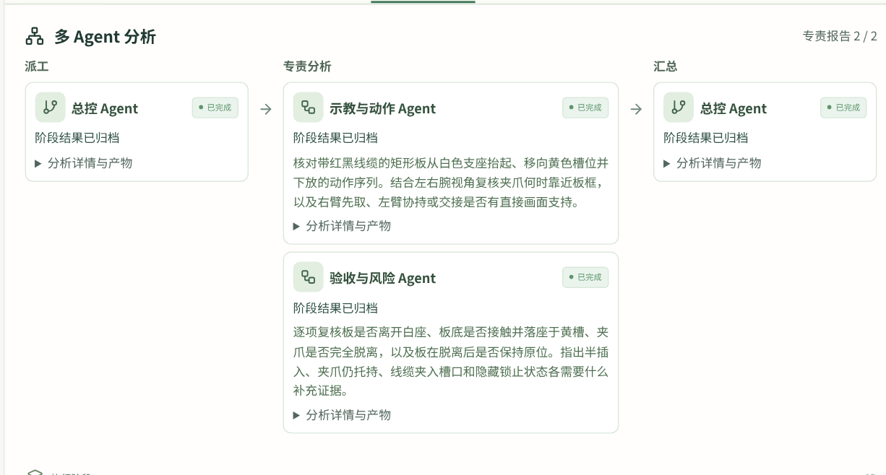
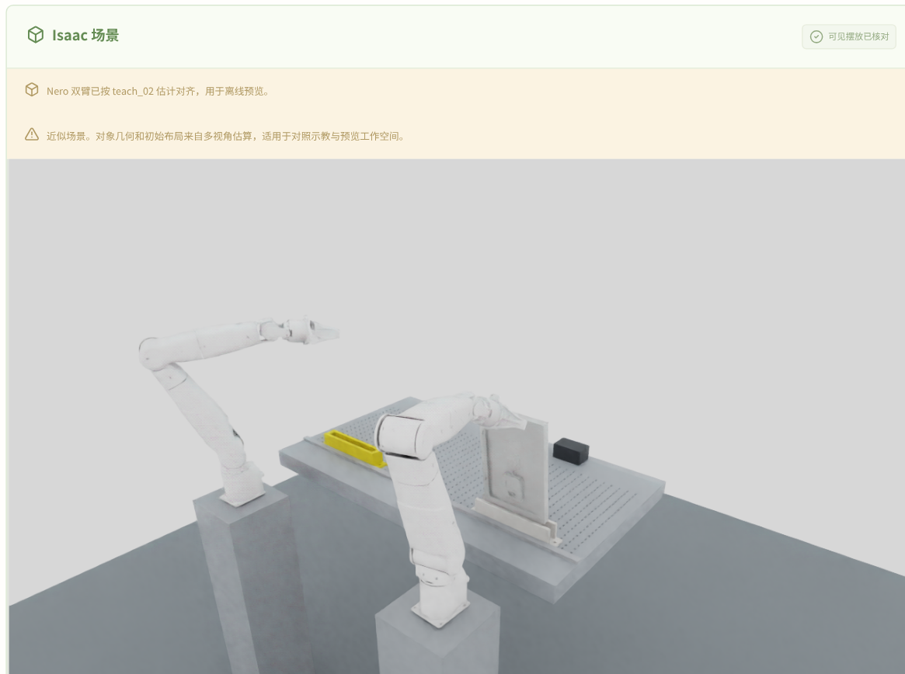
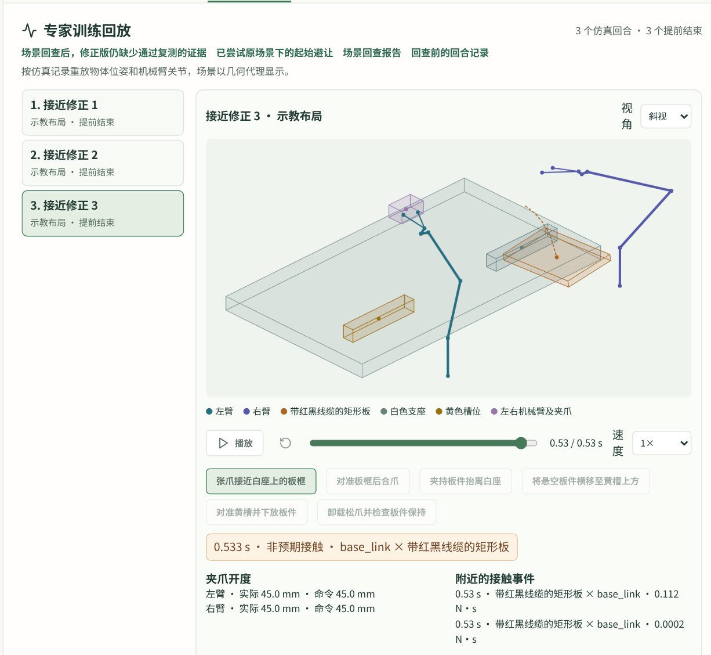
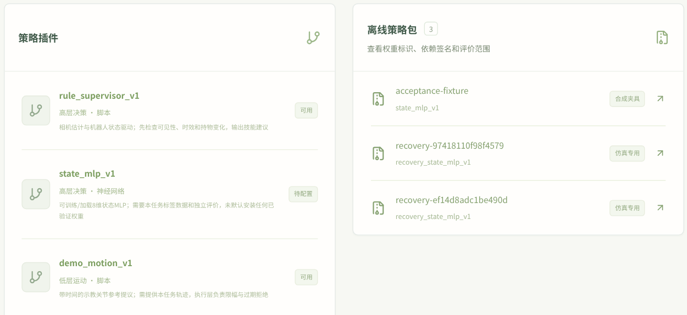
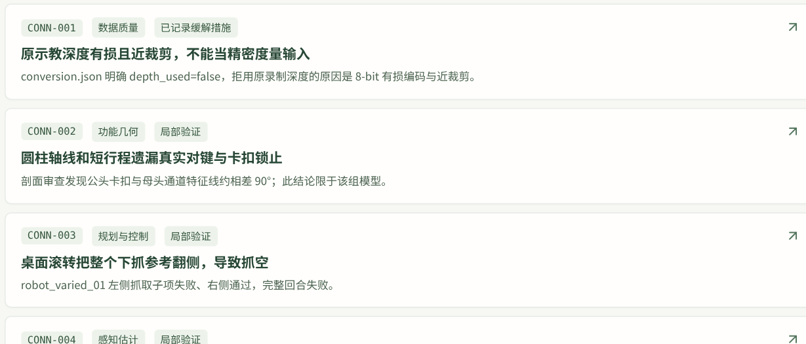
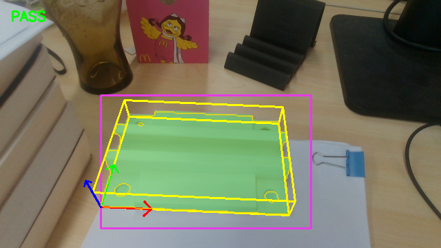
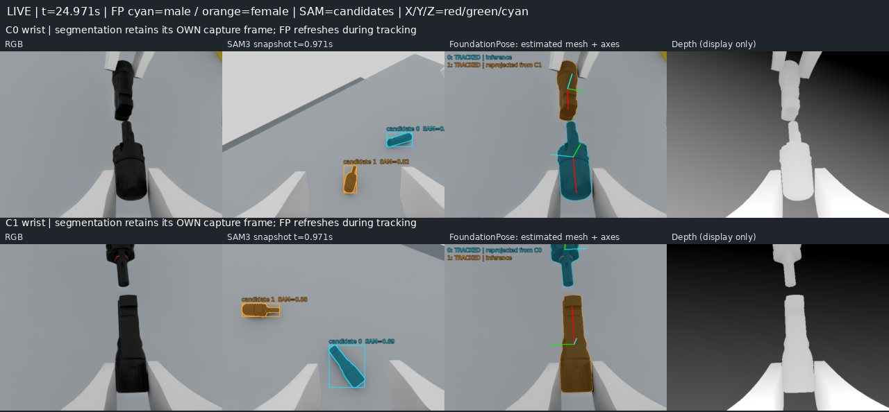

# Demo2Real Agent Workbench 完整流程

本文面向第一次接触项目的读者，以光伏板搬运与入槽研究为例，介绍每种工序一条真实示教、仿真生成专家数据、两层策略复用和实物位姿接入的流程。当前已运行的阶段和后续验证目标在各节标明。建议从 [图解 PDF](Demo2Real_Workbench_Workflow.pdf) 开始，论文定位、相关工作和拟补实验见 [ISARC 论文构思](ISARC_PAPER_PLAN.md)。

## 从哪里开始

工作台的输入是一份 LeRobot 示教目录和一个回合索引。一个真实回合可以同时含外部与腕部图像、双臂关节、夹爪反馈和时间信息。可随示教选择 STL/OBJ，也可使用已绑定的任务资产。构件模型、机器人的 URDF 和标定可提高尺寸与位姿的可复核性。光伏板案例选取索引 2，共 788 帧，包含前视、左腕、右腕与侧视。工作目标是将板件从白色起始支座抬离，搬运至黄色目标槽并检查撤爪后的独立承托。

~~~mermaid
flowchart TD
    A["每种工序导入一个真实双臂示教回合"] --> B["图像、资产、标定与经验审查"]
    A --> T["双臂轨迹、夹爪时序与阶段参照"]
    B --> C["多 Agent 派工、专责分析与汇总"]
    C --> D["结构化任务定义与功能几何"]
    D --> E["Isaac 场景构建、多视角对照与独立检查"]
    E --> F["物理仿真中的示教引导专家迭代"]
    T --> F
    F --> G["原布局筛选"]
    G -->|"通过可测筛选项目"| H["冻结候选，独立验证原布局与留出布局"]
    G -->|"异常接触、掉落或证据缺口"| I["回查场景、轨迹或补充证据"]
    I --> F
    H -->|"经验证的异常决策"| J["高层恢复学生"]
    H -.->|"经验证的连续动作"| N["拟训练低层 ACT 或 Diffusion Policy"]
    J --> K["兼容策略与独立评价"]
    N -.-> K
    K -.-> M["拟接入真实 RGB-D 位姿并开展双臂实机验证"]
    B -.-> L["经验库与失败记录"]
    E -.-> L
    F -.-> L
    H -.-> L
~~~

工作台在本机启动，操作入口与环境要求见 [本地使用与维护](../QUICKSTART.md)。

## 1. 导入、审计与经验检索

- 在「任务工作台 → 导入示教」选择本机源目录、示教索引和可选物体模型。新任务会复制源文件并登记 SHA-256，后续处理读取项目内副本，来源目录保持只读。
- 数据审计读取 LeRobot 元信息、分离或定位选定回合，按已登记的最多四路 RGB 抽样，生成抽帧和联系图。动作建模另按版本绑定关节、时间及双夹爪轨迹；有损深度和跨视角同步等不确定性保存在报告里。
- 根据任务阶段、机构、接触和症状查询历史经验，同时检查资产存在性、格式和可识别的对象。工件可在「产物文件」中按文件名或路径查找。

## 2. 任务理解与版本化定义

- 总控 Agent 基于示教帧、资产与经验派发 2–4 个专责角色。「示教与动作」和「验收与风险」固定参与，「几何与接触」「观测与标定」按证据或所选专责数量参与。总控汇总目标、对象角色、阶段顺序、预期完成条件和证据缺口。
- 「概览」显示当前任务理解和证据来源，「运行记录」保留派工单与专责报告。模型报告是任务候选说明，后续由结构化 schema、几何检查和可执行判据核对。
- 「任务定义 / 场景」建立版本化 `task_spec`，记录观察坐标、机器人/资产、技能阶段、成功条件及待核实项。用户可保存新 revision、构建预览或冻结离线契约。渲染、轨迹、模型和标定均绑定各自使用的版本。
- 缺少必须的输入时，阶段可进入待配置或待回复。「Agent 对话」按任务、阶段和尝试保存问题与答案，后续执行仍经过原有检查。

## 3. 功能几何、场景构建与对照

1. **估计布局。** 利用多视角示教证据识别工作面、支撑关系、板件、起始支座和目标槽。有可靠尺度时使用工作面或模型尺寸交叉核对距离，缺尺度时保留定性结论。
2. **绑定资产和双臂。** 对可匹配的 STL/OBJ 保留文件与哈希，缺件可使用有证据引用的场景代理。Nero 模型绑定左右臂 URDF、双臂基座、手眼/TCP 及可用相机标定。以预览估计对齐时，需要单独核对坐标原点和尺寸。
3. **构建与修正。** 生成真实 Isaac USD 场景、相机预览和配置清单。新示教通常对照录制图像与仿真图像做两轮修正，核对操作对象、支撑、目标位置和方向。局部失败可在既定预算内提出候选碰撞体或摆放修正，再构建并复验。
4. **独立检查并发布。** 重新打开 USD，检查结构、相机、对象稳定性与可核对的场景证据。前端发布通过相应检查的场景版本。接触配合还需核查槽口截面、净空、入槽姿态、摩擦抓取和释放后的承托。

光伏板场景曾出现槽口与板件干涉，白色支座的一版碰撞凸包会跨过两侧槽壁。后续按网格截面生成了保留槽腔的候选碰撞体。候选通过场景局部检查，接近阶段复测仍有非预期接触，未发布为通过动作复测的修正版。真实入槽姿态、末段承托及释放后的稳定性仍待核实。[场景工作流](../TASK_SCENE_WORKFLOW.md) · [本次场景修正记录](../../runs/d89cc5bb00a24ba9/simulation/approach_scene_recheck_1795357466408371484/scene_repair_1795357466416057092/repair_history.json)

## 4. 回放前置检查与动作专家

- 绑定选定回合、双臂顺序、夹爪通道、场景与 URDF，检查时间轴、关节限位及首帧姿态。此前一次光伏板审计曾发现左臂第 4 关节有 224 个样本超出场景 URDF 上限。按离线回放要求保存原始和限位修正两份记录，接触可行性由回合验证。
- 动作专家根据本任务图像、轨迹、场景和经验生成阶段计划，保持连续示教轨迹作为参考。计划描述每段的几何参照、参与手臂、夹爪安排、期望接触和位姿调整；另一路审查把任务结束条件映射成可测判据，证据不足的条目保持未验证。
- 录制轨迹调整路径使用插值和基于雅可比的关节修正。较新的目标点路径按场景或物体参照生成分阶段目标，用录制首帧作为 IK 初值，并把夹爪变化时序作为动作计划证据。PhysX 逐回合执行，依据碰撞、跌落及判据误差修正候选。先筛选原始布局的可测阶段，再扩展至训练变位。早停时保留首次失败阶段并标记未执行的后续检查。
- 筛选通过后冻结动作参数，另跑原布局和未参与候选选择的留出布局，对照固定示教回放。当前普通入口的变位以平面平移为主，组内对象一起移动以保留初始承托关系。留出范围和对象分组应以该次任务计划为准。
- 「专家训练」按已保存的 PhysX 关节与物体轨迹回放，显示候选、阶段、验收、碰撞或跌落时刻。出现早期异常时可把证据返回场景回查。候选场景须经过相同异常阶段复测，原版轨迹、报告和参数继续可追溯。

图中显示光伏板第 3 次尝试的历史回合。基线右夹爪在约 0.0583 s 接触板件。修正支座代理的场景中，4 个候选仍在约 2.08–2.09 s 发生非预期接触。返回原场景尝试 3 条起始避让，异常分别发生在约 0.217、0.533 和 0.533 s。后续第 4 次尝试在修正版场景中按录制开合窗口调整接近，最远的候选仍在约 3.758 s 碰到夹爪本体，未进入位置泛化。[基线](../../runs/d89cc5bb00a24ba9/simulation/action_program_1795357221856795449/expert_learning_report.json) · [第 3 次修正版复测](../../runs/d89cc5bb00a24ba9/simulation/action_program_1795357649840240108/episodes.json) · [第 4 次正式回合](../../runs/d89cc5bb00a24ba9/simulation/action_program_1795358625915068307/episodes.json)

## 5. 泛化数据、学生策略、独立评价和归档

这部分需要上游通过及相应数据配置。**光伏板当前停在动作仿真，以下已验证的训练路径来自 Connector 的独立实验。**

| 环节 | 当前实现与可核对的输出 |
| --- | --- |
| 数据采集 | 从真实 PhysX 回合保存状态特征、决策标签和仿真结果。按回合拆分训练、验证、测试。未验证的重抓不作为成功标签，旧留出证据保留评价用途。 |
| 高层恢复学生 | 当前 Connector 高层 MLP 学习继续、等待、左右重抓或人工介入。后续以同一专家的成功、滑落、异常接触和失败状态建立可观测的状态及恢复标签。训练日志、权重散列、验证集选模及分类指标随运行保存。 |
| 低层连续动作 | 当前脚本执行器承担连续动作和接触控制。拟使用经独立物理检查的专家轨迹训练 ACT 或 Diffusion Policy，按统一接口输出工具参考或关节与夹爪动作。仿真真值和接触事件可为监督提供证据，学生输入应与部署时可得信息一致。 |
| 独立评价 | 按冻结配置分别查看离线分类与物理闭环。闭环报告区分响应正确、确实插接、松爪后保持及人工介入。视觉估计、仿真位姿代理和真值专家的成绩分别使用。 |
| 离线策略包 | 将兼容的权重、评价、版本签名和使用范围归档，在「离线策略」查看。当前包面向离线或影子用途。输出与现场执行之间仍需设备、标定、观测、停止行为及实际试验批次验证。 |

[训练与闭环原始结果](../RECOVERY_V2_RESULTS.md) · [模块及策略接口](../MODULAR_ARCHITECTURE.md) · [离线归档实现](../../modules/deployment/README.md)

## 6. 运行管理、异常反馈与证据追溯

前端通过本地 API 显示 SQLite 中的任务、Worker、Agent、事件和工件。调度器按依赖启动隔离 Worker；取消、重试和中断有独立记录。模型节点依赖可用的模型服务和证据。数据、截图、USD、候选参数、回合轨迹、权重和验收报告随所属示教及派生运行归档。

「经验与失败记录」提供案例检索和问题记录。新的问题带证据与哈希，诊断可追加修订。对光伏板有价值的既有经验包括：核对物体滚转，分开验证视觉匹配和接触精度，检查槽腔与碰撞体，独立测量撤爪保持。采用的是核对方法，当前任务的尺寸、动作和成绩由该任务自身证据确定。[经验资料库](../../knowledge/README.md) · [证据与修订机制](../EXPERIENCE_AND_FAILURE_MEMORY.md)

## 7. 现有结果与验证范围

| 工程证据 | 结果和范围 |
| --- | --- |
| 光伏板 | 一条真实示教已进入多视角建场、版本化定义和 PhysX 试验。旧批次完整留出 **0/3**。后续支座代理修正和接近轨迹试验仍有非预期接触，第 4 次正式尝试未启动新留出。 |
| 场景目标点专家 | 在隔离 Isaac 自由空间夹具中，依据误差把实测夹爪开口从 14.5 mm 调整至 47.5 mm，并冻结复验。该结果覆盖候选反馈、冻结和复验链路。光伏板整段抓取与入槽待用该模式验证。 |
| Connector 真值脚本专家 | 5 个旧条件复核、10 个留出布局的抓取—插接—松爪动作均通过。留出布局内另记的释放后保持为 **6/10**。范围为两个物体各自 XY 每轴 ±10 mm，水平转角 ±5°。 |
| Connector 仿真 RGB-D | Isaac 腕部 RGB-D 经 SAM3 分割、FoundationPose 位姿估计与双视角精修后驱动专家，完成插入和原位开爪，释放后保持失败。 |
| Connector 恢复学生 v2 | 20 个新 PhysX 回合形成监督数据。固定高层权重与脚本底层在 6 个仿真条件中均给出预期响应，其中需插接的 **5/5** 通过动作检查，另一例正确请求人工。 |
| 实物感知与实体执行 | 旧项目有 D435i 实物跟踪记录，结果在相机坐标系中。当前工作台的双臂自主装配与工地部署尚未获得实机验收。 |

[光伏板早期留出报告](../../runs/d4d5f71444d7462b/simulation/action_program_1795341700145055854/expert_learning_report.json) · [光伏板第 4 次正式回合](../../runs/d89cc5bb00a24ba9/simulation/action_program_1795358625915068307/episodes.json) · [目标点夹具](../../.runtime/tests/waypoint-isaac-final/probe_result.json) · [Connector 冻结报告](../FROZEN_EXPERT_RESULTS.md) · [RGBD 回归](../IMPLEMENTATION_STATUS.md#rgbd最终回合) · [恢复学生 v2](../RECOVERY_V2_RESULTS.md)

### 界面与证据位置

| 入口 | 建议查看 |
| --- | --- |
| 任务工作台 | 导入示教，按名称或运行 ID 找到已有任务 |
| 概览 | [任务目标与顺序](workflow-images/03-task-overview.png)、进度、Isaac 场景、异常 |
| 任务定义 / 场景 | [对象、坐标、revision 和冻结](workflow-images/05-task-definition.png) |
| 专家训练 | 录制轨迹对照、候选、留出布局、验收与轨迹回放 |
| 运行记录 / 产物文件 | 派工报告、时间线、工件与输出目录 |
| 离线策略 / 经验与失败记录 | 策略包、已测范围、历史问题与证据 |

截图基于实际工作台和既有记录。界面中的状态属于截图所取的运行版本，结果表按已落盘的实验报告统计。

## 8. FoundationPose 与真机衔接

FoundationPose 在这条路线中负责估计**构件或工装相对于相机的三维位置和朝向**。旧项目 `TP-KMPs-nero-isaacsim` 的基于 CAD 路径输入 RGB、对齐至彩色图像的米制深度、相机内参、SAM3 实例掩膜和有物理尺度的构件模型。初次配准后可持续跟踪。遮挡或几何检查失败时需重新定位。接近对称的构件即使轮廓和深度一致，仍可能有首尾朝向歧义，涉及入槽方向时要用可辨识特征或独立观测复核。[FoundationPose 原论文](https://openaccess.thecvf.com/content/CVPR2024/html/Wen_FoundationPose_Unified_6D_Pose_Estimation_and_Tracking_of_Novel_Objects_CVPR_2024_paper.html)

| 已有记录 | 验证范围 |
| --- | --- |
| 旧项目 D435i 实物跟踪 | 处理 86 帧，82 帧通过视觉质量检查，4 帧被拒绝。相机坐标系诊断，无 CAN 接入，未测绝对位姿精度。[原始汇总](vision-evidence/d435i_tracking_summary.json) |
| 旧项目单臂目标生成联调 | 实际运行 SAM3 与 FoundationPose，在合成 RGB-D 的已知布置变化中完成手眼变换、物体相对抓取绑定、TP-KMP 和有界 IK 预览。旧项目记录 `real_tpkmp/vision/CHECKS.md` 的 `gpu_pipeline_01` 标记为合成，计划不具备实机执行资格。 |
| 当前工作台 Connector | 仿真腕部 RGB-D、SAM3、FoundationPose 与双视角精修为插接专家提供估计状态。记录显示插入和原位松爪通过，释放后保持失败。该链尚未接入光伏板动作专家。[独立报告](vision-evidence/connector_rgbd_report.json) |

图中 PASS 表示这一帧通过视觉质量检查。

双行对应两路腕部视图，分割列保留自己的采样时刻，位姿列显示跟踪结果。[两图与报告的来源及文件哈希](vision-evidence/provenance.json)

### 如何把新工位的观测用于双臂动作

1. **把位姿转换到共同工作坐标。** 固定相机用经过验证的相机到工位外参。腕部相机用手眼外参及与图像时间配对的机械臂实际关节反馈计算相机位姿。核对双臂基座、工具 TCP、相机内参与构件 CAD 的尺度和坐标。
2. **用观测更新阶段参照。** 从示教或已确认的功能几何保留物体到工具的相对抓取关系。新的构件位姿更新接近、夹持和抬升参考，新的工装位姿更新对准和落位参考。旧项目已验证基于相对关系生成单臂抓取参考的离线链；两臂协调、接触和保持由当前工作台另行验证。
3. **分阶段验证执行。** 先用实体相机只读测姿并对照独立参考，记录平移、转角、遮挡失锁及从采图到使用的延迟。随后用实际状态做影子推理，检查轨迹协调、可达性、限位、观测过期和停止。通过独立检查并获得试验批次授权后，再做低速无接触、低速接触和松爪保持试验。
4. **验证可持续作业。** 在固定验收规则下执行多个装配周期。每件完成后记录释放保持、工位或构件变更、恢复和人工介入，再进入下一件。配套记录增补示教、标定、建模、调参与仿真筛选的投入。

规划与策略使用有来源、时间戳和质量状态的物体估计。统一执行层处理设备及观测有效性，视觉与任务分析进程无直接运动权限。历史手眼结果曾因留出检查失败而未能用于运动，接入时应按实际相机和双臂安装重新核验。[部署设计](../IMPLEMENTATION_PLAN.md#7-暂缓的历史设计仿真策略部署到真机)
