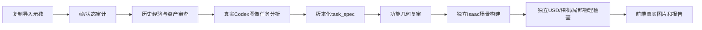

# 从示教任务到可复审场景：当前可运行流程

更新：2026-11-11。本文描述已经跑通的场景里程碑；总体规划继续以 IMPLEMENTATION_PLAN.md 为目标，以 EXECUTION_CHECKLIST.md 为实际进度。

## 1. 已实现的链路

这是“有证据的任务定义与场景预览”链路。建好场景后，通用规划专家、扰动数据生成、学生策略和实机测试仍需继续实现与验证。场景构建不会运行接触动作或连接机器人。

### 示教与模型分析

本次沿用已实体导入的原始LeRobot示教第0回合：555帧，30Hz，18.5秒；源数据总计32回合。Codex实际消费了三视角共12张采样图，产出任务提案、子阶段、证据与未知项。这里复用已成功的模型分析结果，没有为每次场景预览重复请求模型。

Codex CLI使用项目独立登录。角色卡片区分真实模型请求与确定性工具Worker；工具阶段不是又一个语言模型。CLI未回报具体型号时显示CLI默认，不能推断与聊天模型相同。

### task_spec：跨模块边界

`contracts/tasks.py`定义纯JSON契约；`modules/task_specs/`负责生成、编辑、冻结和绑定。

- 每次保存追加不可变revision，不覆盖旧文件；保留字段来源、假设和未知项。
- 修改须带expected_revision或If-Match，旧页面写入冲突会拒绝。
- 资产、示教证据、标定、URDF和任务模板记录hash；依赖改变须重新核验。
- 离线冻结scope为offline_contract，保留未知项，不授予接触执行或硬件权限。
- 每次场景构建固定revision、hash和输入快照；前端把旧构建标为旧版本，不能拿旧图片证明新定义通过。
- 帧父子关系、刚体变换、单位、物体尺寸等检查在CPU层执行；缺少关键输入时返回待配置。

任务模板是显式选择或严格资产签名匹配后的工程配置，不是模型从视频自动测出了质量、摩擦和隐蔽结构。未知任务不会套用Connector参数。

### 功能几何与场景

`modules/geometry/functional.py`检查实际网格、剖面和已有工程参数，输出报告与SVG；没有功能证据时不把PCA主轴直接当插接轴。本次Connector对键几何为约90.0243°，支持原90°工程约定，但不证明实物卡扣尺寸与保持可靠性。

`modules/scene_building/`从固定快照调用独立Isaac子进程，创建桌面、机器人、独立刚体、碰撞模型、腕部相机和相机外壳近似体。Connector接触组件在`tasks/connector/components/`；程序方块走同一个通用构建器。物体不通过关节固定到夹爪或另一物体；允许Connector自身两个被动弹性卡扣。

腕相机使用已授权共用的内参/手眼矩阵，并显式组合URDF父链到SDK法兰的变换、光学坐标到USD相机坐标变换。真实图像包括全景、腕RGB、深度和坐标轴示意。当前场景坐标轴来自仿真/模板参考，**不是SAM3/FoundationPose推理结果**；旧RGBD动作诊断的视觉结果有独立入口和证据。

构建仅保持机器人初始关节姿态并运行1.5秒局部稳定性检查。拍摄后重新采样最终状态，使图像、位姿和USD对应同一暂停时刻。它不运行任务轨迹或策略。

### 独立检查

`modules/scene_validation/`在另一非GPU进程重开导出USD，检查实际PhysicsScene、刚体、相机、关节连接、项目内资源引用、快照/依赖hash、物体位置与局部静稳。实际解码PNG检查尺寸和内容；从USD相机重新核算标定投影和父链安装变换。

这些是内部几何一致性与局部物理证据。不能代替实机标定、抓取/插入、松手保持或泛化评价。

## 2. 前端操作

1. 启动`bash scripts/start.sh`，打开 http://127.0.0.1:8787。
2. 进入原始示教任务`e7320b6960634a63`，在任务定义区域查看、编辑或离线冻结task_spec。
3. 使用当前版本构建场景；系统创建独立场景job，并真实调度经验、功能几何、Isaac构建和独立验证四个节点。
4. 在场景job查看实际全景/腕图、USD、manifest、快照和逐项检查；可返回源任务或查看历史。
5. 修改任务定义后重新构建；原场景保留但标为旧版本。存在未知字段时先补充真实来源，再处理后续动作。

当前浏览器预览是实际Worker生成的静态工件，不是交互式Isaac实时串流。工作台不显示虚假训练进度，不自动启动真机。

## 3. 本次真实验收

| 输入/运行 | 结果 | 证据范围 |
| --- | --- | --- |
| 原始示教源e7320b6960634a63 | 真实模型分析通过；Connector spec r1 | 录制示教及有来源工程模板 |
| Connector场景7a2f6bd23eae482a | 四节点成功；独立78/78检查；浏览器通过 | 双臂、两个独立物体、全景和两腕图；无完整动作 |
| 程序方块源7a640a7ef3e6477b / 场景c9784f26971a43f7 | 四节点成功；独立37/37检查；浏览器通过 | 合成场景夹具，用来验证构建器复用；没有第二条录制示教，没有抓放动作成功 |
| 旧Connector场景e648721d1192409c | 失败保留 | 材质外部路径和遗漏PhysicsScene两个失败及修复依据 |
| 后端回归 | 87 passed / 1 skipped / 1 warning | 跳过项因app环境无pyarrow；登记data Python已有独立解析证据 |
| 前端新增组件/SSR | 18组通过；真实Chrome两成功场景及旧失败页面通过 | 实际图片/报告可访问、revision/hash、历史导航、移动布局 |
| 机器人 | disconnected，0硬件命令 | 未连接、未使能、未发送动作 |

汇总：`runs/acceptance/scenes/end_to_end_report.json`。测试原始输出：`runs/acceptance/scenes/test_output.txt`。

独立逐项报告：`runs/acceptance/scenes/final_<scene_run_id>/validation_report.json`。浏览器报告与四张截图：`runs/acceptance/frontend/task-scene-<scene_run_id>-report.json`及同前缀图片。

## 4. 本次失败、修复与复用

| 问题 | 根因与修复 | 复用记录 |
| --- | --- | --- |
| 有真实图像但USD导出失败 | URDF材质带Kit内置OmniPBR绝对MDL路径；有定义地转换为UsdPreviewSurface并保留材质适配清单，未知外部引用仍拒绝。视觉材质是近似，物理不变。 | INC-ac8e9299e7614526追加r2；原r1保留 |
| USD包含机器人/刚体但无PhysicsScene | 入口只引用/World，遗漏同级/physicsScene；改为本地subLayer组合，独立重开USD确认全部根节点。 | INC-ce9bfa77637d4223追加r2；原r1保留 |
| 自报检查不足以验收导出 | 增加实际刚体、相机安装/投影、关节目标和PNG解码检查；拍摄后重采样最终状态。 | 检查实现与逐项报告，不把manifest自报当独立证明 |

两条事件带原失败证据和修复验证hash，可以按USD/PhysicsScene/OmniPBR检索。它们仍作为未策展incident呈现，修复范围限定为本次场景导出与局部检查，不能扩大到动作或硬件。

## 5. 下一里程碑与顺序

1. 将示教参考、功能帧、观测/动作契约和成功判据绑定到同一task_spec，接入可执行规划/技能专家。先在固定Connector场景完成全动作与负例，再拓展第二条真实示教。
2. 在专家可执行后生成位置/角度及掉落、取走、遮挡等扰动与恢复数据，明确可恢复边界；保留失败和原始轨迹。
3. 先训练物体估计状态+机器人状态的学生，再接真实RGBD感知链；真值只给专家/评价，不泄漏到部署观测。
4. 固定留出位置/扰动、观测时延和失败判据，产出真实checkpoint及泛化报告。现有合成BC验收包不替代该策略。
5. 完成SDK反馈与实机坐标/时钟校验、只读/影子、当前态接续和独立停止，随后进行已授权批次的低速真机测试。

仍未解决：CONN-006松手后保持、较大变位/噪声失败、其他现实障碍缺失、实际相机安装误差与接触参数。不能以本次场景全绿覆盖它们。

## 6. 文件与模块边界

| 职责 | 路径 |
| --- | --- |
| 纯任务契约 | contracts/tasks.py |
| 定义生成/修订/离线冻结 | modules/task_specs/ |
| 功能几何 | modules/geometry/functional.py |
| 真实Isaac构建 | modules/scene_building/ |
| 独立USD/相机/局部物理验收 | modules/scene_validation/ |
| 薄Worker入口 | workers/build_scene.py、workers/check_scene_usd.py |
| 任务专用模板与机构 | tasks/connector/、tasks/rigid_pick_place/ |
| 失败修订与检索 | modules/experience/、knowledge/incidents/ |

所有业务文件、运行产物、日志及可控缓存都在本新目录。大型运行环境只读复用，唯一入口为config/environments.yaml；本次没有修改原项目或共享环境。
